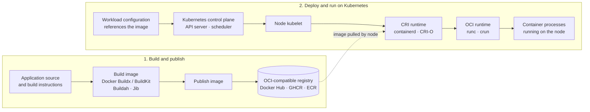
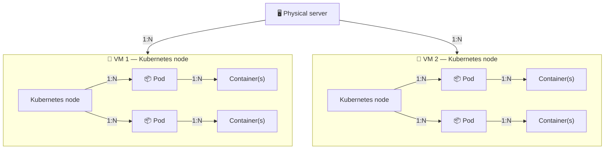

# Containers FAQ

## Images

### Is a container image like a ZIP file, and can I view its contents?

**In some ways, yes:** an image packages files needed by an application, but it is more than a single ZIP archive. An OCI image includes filesystem layers plus metadata and configuration that describe the image and how to run it. Layers can be shared between images, so the image is not necessarily stored as one simple archive.

You can inspect image metadata and browse its files:

- `docker image inspect IMAGE` displays metadata such as its layers, environment defaults, and startup command.
- `docker create --name inspect-temp IMAGE` followed by `docker export inspect-temp -o container-filesystem.tar` exports a container filesystem for browsing. Remove the temporary container afterward with `docker rm inspect-temp`.
- `docker save -o image.tar IMAGE` saves the image, including its layers and metadata, to a tar archive. You can list or extract the archive with standard archive tools, but its contents are organized as image layers rather than one ordinary application folder.

The exported container filesystem is the merged filesystem view; it does not show the image's layer structure or all image metadata. Do not start an untrusted image just to inspect it.

### Can an image created with one platform run on another engine?

Usually, yes. For example, an image built with Docker can generally be pulled and run by Podman. Docker-built images commonly use OCI-compatible image formats, which are supported by many engines and runtimes.

Compatibility is not an absolute guarantee. The target engine must support the image format and platform, and the image must match the host architecture (or provide a compatible multi-platform variant). Runtime-specific assumptions, such as special networking, mounts, or security settings, may also need adjustment. Image portability does not necessarily mean that every command-line option or orchestration feature works identically across engines.

## Container Platforms and Runtimes

### What are the main container technologies, and how do they differ?

“Container engine” is often used as an umbrella term. The tools below operate at different layers, so they are not all direct alternatives:

| Type | Examples | What it does | When to use it |
|---|---|---|---|
| **Developer-facing container platform** | Docker Engine, Podman | Provides commands to build or pull images and create, run, and manage containers. Docker Engine uses a daemon; Podman is designed to work without a central daemon and supports rootless workflows. | Use Docker for a widely supported development workflow and ecosystem. Consider Podman when daemonless or rootless operation is important, after checking compatibility with your tooling. |
| **Kubernetes node runtime** | containerd, CRI-O | Runs and manages containers on Kubernetes nodes and integrates with Kubernetes through the Container Runtime Interface (CRI). | Use the runtime provided or recommended by your Kubernetes distribution. Choose CRI-O when you want a Kubernetes-focused runtime; containerd is a widely used general-purpose runtime component and is also used by Docker Engine. |
| **Low-level OCI runtime** | `runc`, `crun` | Creates and runs an individual container process according to the OCI Runtime Specification; usually invoked by a higher-level tool. | Typically not chosen directly for everyday image building or container management. Select or tune it when operating a platform that exposes runtime choices or when you have specific host/runtime requirements. |
| **System-container manager** | LXC/LXD | Manages system containers that provide a more machine-like Linux environment, rather than focusing only on packaging an application process. | Consider it for long-running Linux environments or system-container workloads; it is not a drop-in replacement for an OCI application-container workflow. |

For typical application development, start with Docker or Podman. For Kubernetes, use a supported node runtime such as containerd or CRI-O; Kubernetes talks to that runtime through CRI. The low-level OCI runtime is usually a component beneath those tools, not a separate command users need to run.

### How do container platforms, OCI runtimes, and Kubernetes fit together?

Developer-facing platforms such as Docker and Podman help build or pull images and create, run, and manage containers. They commonly rely on a lower-level OCI runtime, such as `runc` or `crun`, to start container processes. Some tools, including containerd and CRI-O, primarily serve as container runtimes and are not general-purpose image-building platforms.

Kubernetes is an orchestrator, not just a node manager. It schedules workloads across nodes and manages their desired state, networking, scaling, and recovery. On each node, the kubelet communicates through CRI with a compatible runtime, commonly containerd or CRI-O, which starts containers from images.

The registry stores and distributes the image. When Kubernetes schedules a Pod, the node's kubelet asks its CRI runtime to ensure the referenced image is available and start the container.

In short: image building, container execution, and cluster orchestration are related but distinct responsibilities. A platform may include or use components for more than one of these jobs.

## Kubernetes Cluster Structure

### How do physical servers, VMs, nodes, and Pods fit together?

A Kubernetes **node is a machine**—physical or virtual—that has joined the cluster. In a VM-based setup, each VM commonly serves as one node; a physical server can host multiple VMs. Each node can run multiple Pods, and each Pod contains one or more containers.

This shows a common arrangement, not a requirement: Kubernetes can also run directly on physical machines, and a cluster's nodes can be spread across multiple physical servers.
