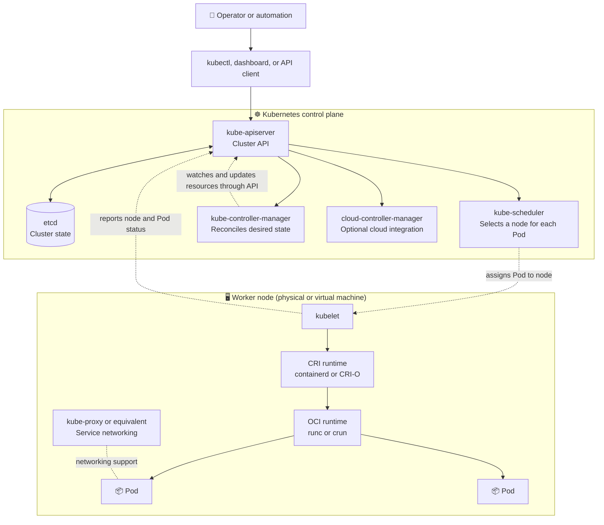

# Kubernetes High-Level Architecture

Kubernetes is a container orchestrator. It runs a **control plane** that accepts and coordinates desired state, and **worker nodes** that run application workloads. A node is a physical or virtual machine; Kubernetes schedules Pods onto nodes, and each Pod contains one or more containers.

## Architecture at a Glance

The diagram shows the main responsibilities; real clusters may run components in different arrangements, and some networking implementations replace or do not require `kube-proxy`.

## Control Plane Components

- **`kube-apiserver`** is the front door to the Kubernetes API. Users, tools, and cluster components submit requests and watch for changes through it.
- **`etcd`** is the backing key-value store for Kubernetes cluster state. The API server reads and writes this state; clients should interact through the API server rather than access etcd directly.
- **`kube-scheduler`** watches for Pods that have not yet been assigned to a node and selects a suitable node based on resource availability, constraints, and policies. It assigns the Pod; it does not start the container.
- **`kube-controller-manager`** runs controllers that continually compare actual state with desired state and make changes through the API. For example, a Deployment controller helps ensure the requested number of Pods exists.
- **`cloud-controller-manager`** is optional and integrates Kubernetes with a cloud provider for infrastructure-related functions such as load balancers, routes, or node information.

## Worker Node Components

- **`kubelet`** is the node agent. It watches the API for Pods assigned to its node, asks the container runtime to make their containers run, and reports status.
- **Container runtime** such as **containerd** or **CRI-O** pulls images and manages container lifecycle. The kubelet communicates with it through the Container Runtime Interface (CRI).
- **Low-level OCI runtime** such as **`runc`** or **`crun`** is typically invoked by the higher-level runtime to create and start container processes.
- **Pod networking** lets Pods communicate. A Container Network Interface (CNI) plugin commonly provides networking; `kube-proxy` or an equivalent implementation helps provide Kubernetes Service networking.

## What Happens When You Deploy an Application?

1. A user or delivery tool submits a workload definition—such as a Deployment that references a container image—to the API server.
2. The API server validates the request and stores the desired state in etcd.
3. Controllers notice the requested Deployment and create the required Pod objects.
4. The scheduler selects a suitable node for each unscheduled Pod and records the assignment through the API.
5. The node's kubelet notices its assigned Pod and asks the CRI runtime to pull the image if needed and start the container. Networking is configured for the Pod.
6. The kubelet reports status. Controllers continue reconciling so the cluster moves toward the requested state—for example, replacing a failed Pod.

Kubernetes manages workloads and tracks node health and capacity, but it does not usually provision or maintain the underlying machines or their operating systems. Cloud platforms or infrastructure-management tools typically handle that part. For the physical server → VM/node → Pod relationship, see [Containers FAQ](../Container-FAQ.md).
