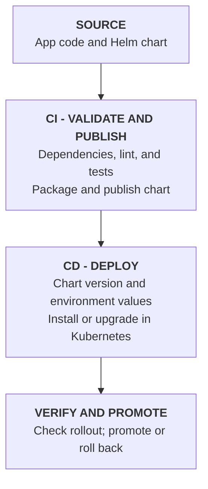

# Helm in CI/CD

The chart in the app’s Git repository is the Helm chart definition. CI validates and packages that definition; CD installs the packaged chart (or the chart directly from the repository) into a Kubernetes cluster.



## Helm Chart Definition

The chart in the app’s Git repository is the Helm chart definition — its source files, such as Chart.yaml, values.yaml, and the templates/ directory.

For an application-specific chart, the chart is usually kept in the application's existing Git repository alongside its source code and CI/CD configuration. This keeps application and deployment changes versioned and reviewed together. A separate chart repository can make sense when charts are shared across multiple applications or maintained by a platform team.

If another build step generates the chart, generate it first; run the Helm validation and packaging steps afterward.

A typical repository layout might look like this:

```text
my-repo/
├── .github/
│   └── workflows/
│       └── helm-ci.yaml
└── charts/
    └── mychart/
        ├── Chart.yaml
        ├── Chart.lock             # Optional; generated for chart dependencies
        ├── values.yaml
        ├── values-dev.yaml        # Optional environment-specific overrides
        ├── values-prod.yaml       # Optional environment-specific overrides
        ├── charts/                # Optional; downloaded chart dependencies
        └── templates/
            ├── _helpers.tpl
            ├── deployment.yaml
            ├── service.yaml
            └── ingress.yaml
```

In this layout, CI commands should point to `./charts/mychart` instead of `./mychart`. `helm dependency build` downloads declared dependencies into the chart's `charts/` directory when needed.


## Prerequisites

The chart must exist before CI can validate or package it. Typically, the repository already contains `Chart.yaml`, `values.yaml`, and `templates/`, along with any dependency declarations. CI runs after a change is pushed or a pull request is opened, then checks and packages the chart.

## Helm in CI

Continuous Integration (CI) typically validates and packages a chart after a change. It does not usually need access to a Kubernetes cluster. A typical chart pipeline might run:

```bash
helm dependency build ./charts/mychart
helm lint ./charts/mychart
helm template myapp-ci ./charts/mychart -f ./charts/mychart/values-dev.yaml --namespace ci
helm package ./charts/mychart
helm push ./mychart-0.1.0.tgz oci://registry.example.com/helm-charts
```

These commands build chart dependencies, check chart structure, render manifests to catch template errors, package the chart, and publish the versioned package to an OCI registry. Replace the chart path, values file, version, and registry with those used by your project. The chart version in the package must match its `version` in `Chart.yaml`.

The CI job should authenticate to the registry using credentials stored in the CI platform's secret store. It should publish a chart only after the required checks pass.

## Helm in CD

Continuous Delivery/Deployment (CD) takes a validated chart version and deploys it to the target cluster. The runner must have Helm installed and authenticated Kubernetes access for the intended cluster. A typical deployment command is:

```bash
helm upgrade --install myapp \
  oci://registry.example.com/helm-charts/mychart \
  --version 0.1.0 \
  -f ./charts/mychart/values-prod.yaml \
  --namespace prod \
  --create-namespace \
  --wait \
  --timeout 5m
```

`upgrade --install` creates the release if it does not exist, or upgrades it if it already exists. Pinning `--version` deploys a specific chart version. CD can deploy that same immutable chart version to development, staging, and production with the appropriate values file for each environment. Use protected approvals or promotion rules before production deployment as required by your process.

After deployment, the pipeline can verify the release and workload:

```bash
helm status myapp --namespace prod
kubectl rollout status deployment/myapp --namespace prod --timeout=5m
```

If a deployment fails, the pipeline or operator can inspect release history and roll back:

```bash
helm history myapp --namespace prod
helm rollback myapp 1 --namespace prod --wait
```

The rollback revision (`1` here) is an example; choose the appropriate revision from `helm history`. CI/CD systems differ, but these Helm commands are commonly run as pipeline steps. Keep cluster credentials and sensitive configuration in the platform's secret-management facilities rather than committing them to the chart or values files.
